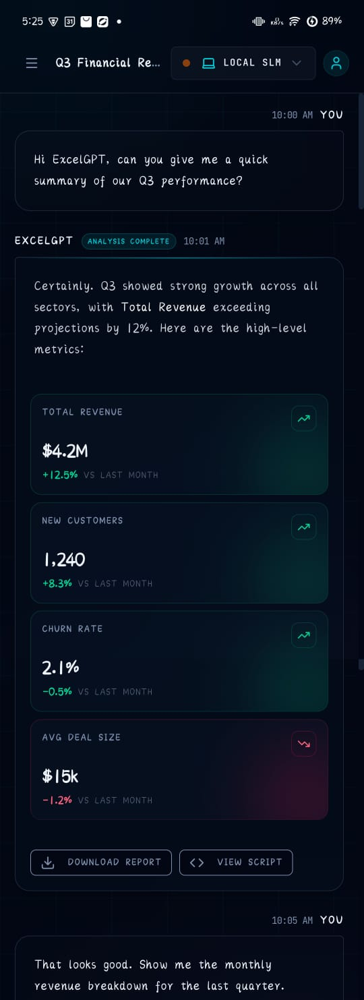
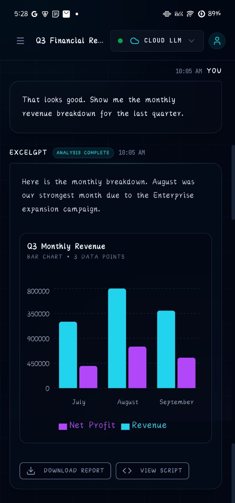
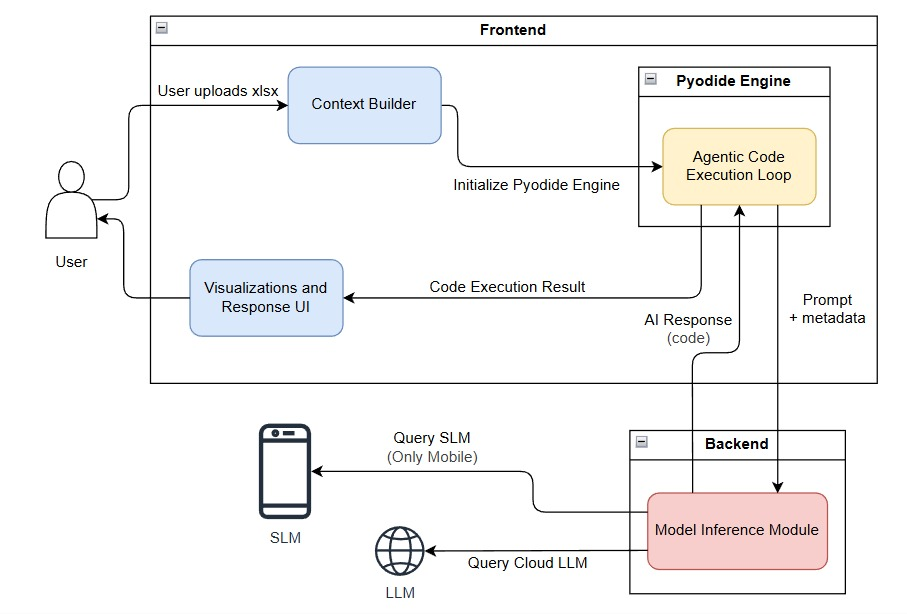

<div align="center">
    
  <h1>Holy Sheets</h1>

  <h3>Your spreadsheets. Your questions. Your analysis.</h3>

  <p>
    <strong>
      A privacy-conscious, AI-powered data analyst for Excel and CSV files
      — with browser-based Python execution and an on-device offline mode.
    </strong>
  </p>

  <p>
    <a href="https://nextjs.org/">
      
    </a>
    <a href="https://www.typescriptlang.org/">
      
    </a>
    <a href="https://pyodide.org/">
      
    </a>
    <a href="https://capacitorjs.com/">
      
    </a>
    <a href="https://github.com/ggml-org/llama.cpp">
      
    </a>
  </p>

</div>


## 🧬 What is Holy Sheets?

Holy Sheets turns natural-language questions into spreadsheet analysis.

Upload an Excel or CSV file, ask a question such as **"Show me total
sales by category"**, and let the AI generate Python code to perform the
analysis. The code runs against your spreadsheet in a local Pyodide
runtime, and the result is presented as a table, chart, KPI, or written
summary.

Rather than asking an AI model to calculate values from a large
spreadsheet, Holy Sheets uses the model for **reasoning and code
generation**, while Python performs the actual computation.

## ✨ Features

- **Ask questions in plain English** --- query spreadsheet data
    without writing formulas or code.
- **Multiple result formats** --- generate tables, charts, KPIs, and
    summaries.
- **Local data processing** --- use Pyodide, pandas, and Python to
    process spreadsheet data in the browser/WebView.
- **Hybrid AI modes** --- connect to cloud model providers or use a
    local small language model (SLM) on supported mobile builds.
- **Offline analysis** --- use on-device inference for supported
    queries without depending on a cloud model.
- **Execution-feedback loop** --- when generated code fails, the agent
    can use execution errors and the actual dataframe schema to attempt
    a correction.
- **Follow-up questions** --- continue an analysis using recent
    conversation context.
- **Excel support** --- work with Excel and CSV files, with support
    for generating new Excel files.
- **Provider flexibility** --- the cloud model layer supports Gemini,
    OpenAI, Groq, and custom endpoints.

## 🖼️ Preview

<table>
  <tr>
    <td align="center">
      <b>KPI Insights</b>
      <br />
      
    </td>
    <td align="center">
      <b>Visual Analysis</b>
      <br />
      
    </td>
  </tr>
</table>

> More application screenshots are available in the
[screenshots/](./screenshots) folder.

## ⚙️ How it works

The central idea is simple: **the AI writes the analysis; Python
executes it.**

``` text
Excel / CSV
    │
    ▼
Pyodide + pandas
    │
    ├── Spreadsheet data stays in the local runtime
    │
    └── Schema + user request
              │
              ▼
        Cloud LLM / Local SLM
              │
              ▼
        Generated Python code
              │
              ▼
       Execute against dataframe
              │
        ┌─────┴─────┐
        │           │
      Success     Error
        │           │
        ▼           ▼
   Structured    Error + schema
      JSON        feedback
        │           │
        │       Retry generation
        │           │
        └─────┬─────┘
              ▼
       React result renderer
              │
       Table / Chart / KPI /
         Markdown summary
```

### 1. Load the spreadsheet locally

The uploaded file is read as bytes and written to Pyodide's virtual
filesystem. pandas then loads it into a dataframe. Excel and CSV files
are handled using the appropriate pandas reader.

### 2. Give the model context, not the whole workbook

The model receives the dataframe schema, relevant context, and the
user's question. The spreadsheet's full contents remain in the local
Python runtime rather than being sent wholesale to the model.

### 3. Generate Python, then execute it

The model generates Python code using the dataframe's actual column
names. Pyodide executes that code against the real data, so calculations
are performed by Python rather than estimated by the language model.

### 4. Return a predictable result

The generated code serializes its result into a structured JSON format.
The frontend uses the result type to render the appropriate component
--- a table, chart, KPI, or Markdown summary.

### 5. Recover from execution errors

If execution fails, the agent can inspect the error and the dataframe's
actual columns, then provide that feedback to the model for another
attempt. This is a schema-grounded, execution-feedback correction loop
--- not a guarantee that every generated query will succeed.

## 🧠 Cloud AI and on-device AI

Holy Sheets separates the model interface from the analysis pipeline.
Both cloud and local models are expected to generate Python for the same
execution workflow.

| Mode | Model Execution | Best Suited For |
|:---:|---|---|
| ☁️ **Cloud** | Next.js API route connected to a supported AI provider | Complex queries and cloud-backed analysis |
| 📱 **Local** | On-device SLM through a native Capacitor plugin powered by llama.cpp | Offline analysis and privacy-sensitive workflows |

The cloud provider adapter supports Gemini, OpenAI, Groq, and custom
endpoints. The local mode uses llama.cpp to run a quantized model on
supported mobile devices.

> **Note:** Local inference depends on the device, model, available
> memory, and runtime configuration. It is intended for simpler
> spreadsheet queries; it is not a drop-in replacement for larger cloud
> models.

## 🏗️ Architecture

### Architecture Diagram


### Spreadsheet analysis pipeline

``` text
Next.js / React
      │
      ├── Upload + conversation UI
      │
      ├── AI orchestration
      │      ├── Cloud model adapter → Next.js API → Provider
      │      └── Local model adapter → Capacitor native plugin
      │                                      │
      │                                  llama.cpp
      │
      └── Pyodide (WebAssembly)
              └── Python
                    ├── pandas
                    ├── NumPy
                    └── openpyxl
```

### Mobile local-inference bridge

On Android, the Capacitor plugin bridges the TypeScript application to
native code through JNI and C++, which integrates llama.cpp. The Android
native build includes CPU and Vulkan backend support.

The documented iOS path uses Capacitor with Swift and Objective-C++ to
bridge to the C++ inference engine.

## 🧰 Tech stack

| Area | Technologies |
|---|---|
| 🖥️ **Application** | Next.js, React, TypeScript |
| 🎨 **UI & Styling** | shadcn/ui, Tailwind CSS, Framer Motion |
| 🐍 **In-browser Python** | Pyodide, WebAssembly |
| 📊 **Data Processing** | Python, pandas, NumPy, openpyxl |
| 📈 **Data Visualization** | Recharts |
| 📱 **Mobile Runtime** | Capacitor |
| 🧠 **Local Inference** | llama.cpp, C++, JNI, Vulkan (Android) |
| ☁️ **Cloud AI Providers** | Gemini, OpenAI, Groq, custom endpoints |
| 📦 **Package Manager** | pnpm |

## 🚀 Getting started
Try at your own risk. This is a research project and not a production-ready.

### Prerequisites

-   Node.js
-   pnpm
-   A supported browser for the web application
-   For cloud AI mode: credentials for a supported provider, configured
    using the project's expected settings
-   For local mobile inference: the relevant native build toolchain and
    a compatible model

### Run the web application

``` bash
# Clone the repository
git clone https://github.com/<your-username>/holy-sheets.git

# Enter the project
cd holy-sheets

# Install dependencies
pnpm install

# Start the development server
pnpm dev
```

Open the local URL printed by Next.js in your terminal.

> **Configuration:** Set up your AI provider and credentials using the
> configuration flow or environment-variable names documented in the
> project. Do not commit API keys or other secrets. Exact provider
> configuration and native build steps depend on the current repository
> setup.

## 🔐 Privacy and execution considerations

Holy Sheets is designed to keep spreadsheet data in the local Pyodide
runtime and send the model the schema and question needed to generate an
analysis. When using a cloud model, the request still leaves the device;
review the provider and its data-handling terms before working with
sensitive information. Local SLM mode is intended for workflows where
the model and analysis can run on-device.

Generated Python is executable code. Pyodide's WebAssembly environment
provides an isolation boundary, but that should not be interpreted as an
absolute security guarantee. Do not use the application with untrusted
files or sensitive data unless you have reviewed the implementation's
validation, sandboxing, and resource-limit protections.

## 🗺️ Project goals

Holy Sheets explores how AI-assisted analysis can be made more practical
by combining:

-   Natural-language interaction
-   Deterministic Python-based computation
-   Schema-grounded code generation
-   Execution feedback and iterative correction
-   Cloud and on-device model options
-   Local-first spreadsheet processing

The goal is to make spreadsheet analysis more approachable without
making the language model responsible for arithmetic.

## 🤝 Contributing

Ideas, bug reports, and improvements are welcome. If you find an issue
or have a feature suggestion, open a GitHub issue with steps to
reproduce or a clear description of the proposed change.

## 📄 License

Add the repository's chosen license here before publishing. Until a
license is included in the repository, reuse and redistribution
permissions are not explicitly granted.

---

<h4 align="center">Built to turn spreadsheet questions into executable analysis.</h4>

---
> P.S: 🙏🏻 This was one hell of a project. It **somehow** worked and I don't know "how?", "why?" and "will it again?". I had little to no idea about SLM, native mobile app development, etc but somehow managed to got this working with the help of AI.
